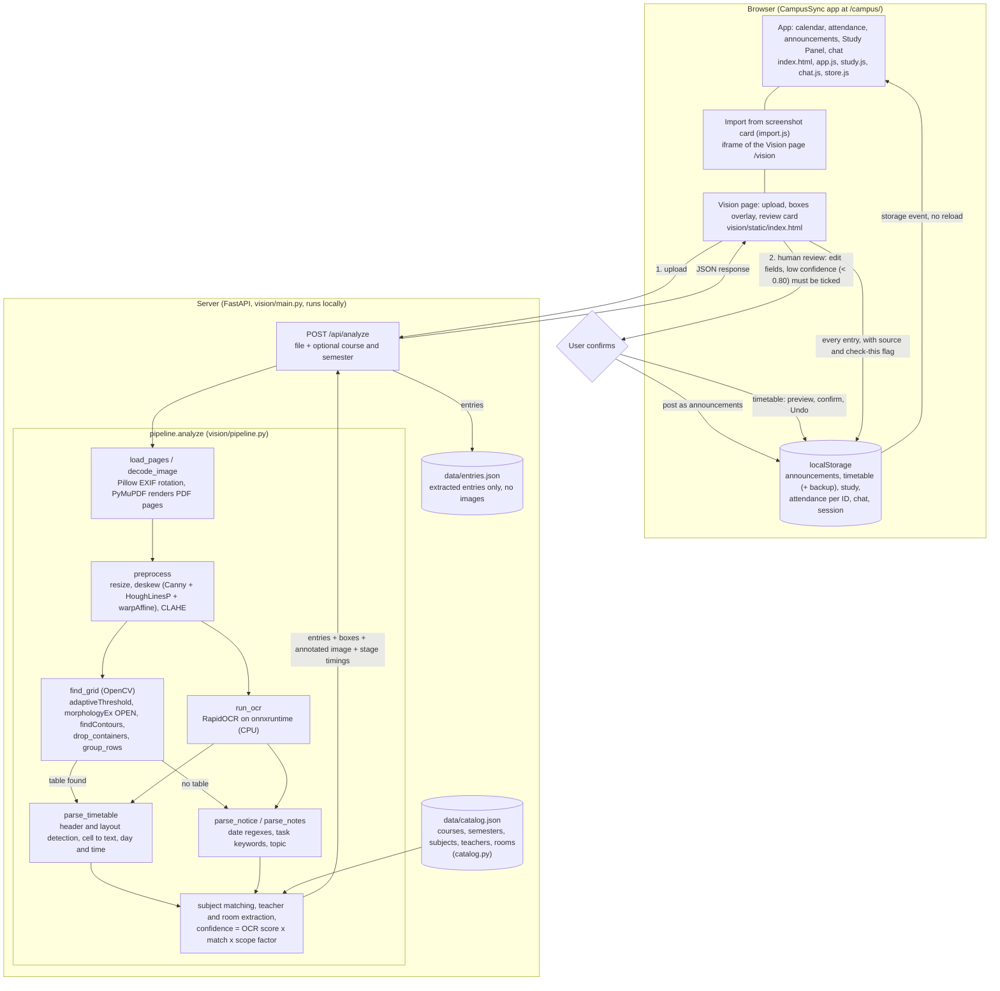

# Architecture

This diagram shows the data flow that exists in the code. Every box is a real function, file or store; nothing planned or hypothetical is drawn. **There is no cloud component: the project runs locally and is not deployed on AWS.**

## How to read it
1. **Upload.** The Vision page (shown inside the app's Study Panel, or alone at `/vision`) sends the file to `POST /api/analyze`. Nothing leaves the machine: the server is local and contains no outbound network calls.
2. **Pipeline.** The image is loaded (EXIF rotation for photos, page rendering for PDFs), deskewed and contrast-corrected, then two things happen on the cleaned image: OpenCV finds table cells (`find_grid`), and RapidOCR reads text blocks (`run_ocr`). If a table was found, `parse_timetable` assigns text to day and time columns; otherwise `parse_notice` (and `parse_notes` as a last resort) read dated lines. Subjects are matched to `data/catalog.json` (limited to the chosen course and semester when one is chosen), teacher and room are extracted and marked as read from the image or filled from the catalog, and every entry gets a confidence value.
3. **Response and server storage.** The response carries the entries, the detected boxes, the cleaned image (as base64, for the overlay) and stage timings. The server saves only the extracted entries (with the source file name and, for notices, the original sentence) to `data/entries.json`. It does not save the uploaded file or the image.
4. **Review.** Nothing reaches the app on its own. For notices, a review card lets the user edit each entry; entries under 80% confidence must be ticked as checked before they can be posted. For timetables, a preview shows lectures added and removed and a warning for attendance marks that would be hidden; replacing needs a click, and Undo restores the old timetable.
5. **Storage.** The app has no database. Approved results are written to the browser's `localStorage`; every extracted entry is also added to the Study Panel store, with its source and a "check this" flag when confidence is under 0.80. The app reads these keys and updates through the browser's `storage` event.

## What is not in the diagram because it does not exist
No AWS service, no container, no load balancer, no database server, no user accounts on a server, no message queue. See [TECHNICAL_REPORT.md](TECHNICAL_REPORT.md), section "Deployment".
